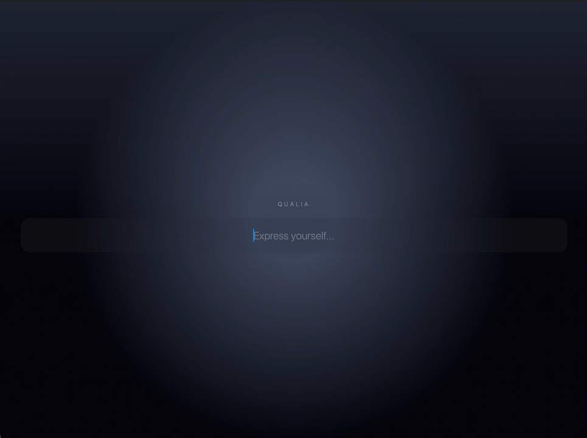

# QualiaKit

Add text-driven haptic feedback to a Swift app. Start with on-device English
sentiment: pass a paragraph, get a score and feel a short pulse. No server,
API key or model download.



*Recording of an earlier demo. The current minimal example is shown below.*

## Install

Requires **iOS 16+ or macOS 13+**, Swift 5.9+.

In Xcode, choose **File → Add Package Dependencies**, enter
`https://github.com/QualiaKit/QualiaKit.git`, select **Branch → main**, and add the
**QualiaKit** product to your app target.

The API below is currently on `main`, not in a tagged release. Tags `1.0.0`–`3.0.0`
contain the legacy API. For a reproducible app build, pin the tested revision
before shipping; do not select an old version expecting this example to compile.

## First reaction

Paste this complete screen into a SwiftUI app and open `FeedbackView()`:

```swift
import SwiftUI
import QualiaKit

@MainActor
struct FeedbackView: View {
    @StateObject private var feedback = SentimentFeedback()
    @State private var text = "This is a wonderful, joyful day!"

    var body: some View {
        Form {
            TextField("One English paragraph", text: $text, axis: .vertical)
            Button("Analyze and feel") {
                Task { await feedback.analyze(text) }
            }
            .disabled(!feedback.isReady || feedback.isProcessing)

            if let score = feedback.score {
                Text("Sentiment: \(Int((score * 100).rounded()))/100")
                Text(feedback.playedHaptic ? "Pulse played." : "No pulse.")
            }
            if let error = feedback.error {
                Text("Could not finish: \(String(describing: error))")
                Button("Retry setup") { feedback.reset() }
            }
            if !feedback.supportsHaptics {
                Text("Analysis works here. Feel the pulse on a compatible iPhone.")
            }
        }
        .sentimentFeedback(feedback)
    }
}
```

`SentimentFeedback` chooses the analyzer, creates input IDs and manages its
session. `.sentimentFeedback(feedback)` handles screen visibility and app
activity: pending work is cancelled when leaving, playback stops, and returning
never replays old text. Keep one feedback instance per screen and attach the
modifier once to the screen's outer view.

The score runs from **0 (negative)** to **100 (positive)** in this example.
The underlying `score` is 0…1. A positive paragraph produces a sharper pulse;
a negative paragraph produces a softer one. Near-neutral text produces no pulse.
Each paragraph is independent, including when submitted immediately after another.
The score describes the text's sentiment, not the reader's feelings or confidence
in a prediction.

## Run the example

Open [QualiaExample.xcodeproj](Examples/QualiaExample/QualiaExample.xcodeproj),
select your signing team for a device build, and run. The example requires
Xcode 16.4+. A simulator or Mac can show analysis results; physical feedback
requires a compatible iPhone.

The app contains just [the screen](Examples/QualiaExample/QualiaExample/ContentView.swift)
and [the app entry point](Examples/QualiaExample/QualiaExample/QualiaExampleApp.swift).
Try positive, negative and neutral text, then toggle haptics off: analysis still
works. **Reset** clears the result and retries failed setup or playback.

## Common tasks

| Task | API |
| --- | --- |
| Analyze and optionally play a pulse | `await feedback.analyze(text)` |
| Read the latest score | `feedback.score` (0…1, or `nil`) |
| Check whether a pulse played | `feedback.playedHaptic` |
| Show a failure | `feedback.error`, including playback and cleanup errors |
| Bind an app preference | `Toggle("Haptics", isOn: $feedback.hapticsEnabled)` |
| Start without vibration | `SentimentFeedback(hapticsEnabled: false)` |
| Clear the result and retry setup | `feedback.reset()` |
| Integrate UIKit | Retain `SentimentFeedback`; call `setActive(true)` only while visible and the app is active, and `setActive(false)` otherwise |

Changing the haptic preference stops pending playback and clears the previous
result. Unsupported hardware uses analysis only, reported by `supportsHaptics`.
An actual playback failure is exposed as an error; it is not reported as success.
New analysis replaces pending analysis. Cancelling the calling task also cancels
its work; a completed pulse cannot be undone.

### Supported input and errors

The built-in path supports **one English paragraph, up to 4,000 characters**.
It does not translate text, detect narrative suspense or infer a person's emotions.

| Error | Action |
| --- | --- |
| `emptyInput` | Supply nonblank text |
| `unsupportedInputStructure` | Submit one paragraph at a time |
| `currentTextExceedsContextBounds` | Shorten the paragraph to at most 4,000 characters |
| Setup, playback or cleanup failure | Display the error; call `reset()` to retry before accepting more input |

No network requests or analytics are used by the built-in path. Provide a visible
result alongside vibration, and connect `hapticsEnabled` to the user's preference.

## Custom models and reactions

Use the ready-made feedback above for independent English paragraphs. Use
`QualiaSession` when your app needs another analyzer, retained story context,
custom haptic rules or narrative effects. These APIs remain available; moving to
the simpler component is optional.

| Product | Purpose |
| --- | --- |
| **QualiaKit** | `SentimentFeedback`, SwiftUI integration and advanced sessions |
| `QualiaCoreML` | Your own Core ML or BERT model; [integration guide](Packages/QualiaCoreML/README.md) |
| `QualiaTesting` | Synthetic analyzers, recording renderers and a controllable clock |
| `Qualia`, `QualiaBert` | Compatibility with existing legacy applications |

Implement `QualiaAnalyzing`, then construct
`QualiaSession.configured(analyzer:renderer:configuration:)`. Choose a policy
that matches the analyzer's advertised signals. The named `sentimentPreview`
and `horrorNarrative` factories validate this compatibility. A narrative policy
needs a narrative-capable analyzer; the built-in sentiment analyzer cannot supply
suspense or threat predictions. No trained narrative model is bundled.

For an advanced session, retain it across inputs, give accepted fragments unique
IDs, and await `suspend()` / `resume()` at visibility boundaries and `reset()` when
starting over. Serialize these calls and handle cleanup errors. Inspect both
thrown errors and `response.execution.failure`. The ready-made `SentimentFeedback`
component handles these details for its own session.

The advanced SwiftUI modifiers `qualiaReaction` (accepted events) and
`qualiaLiveReaction` (debounced drafts) take an explicit session. Use a separate
session for drafts so preview does not advance an accepted story. See the
[public consumer examples](Tests/Consumer/Tests/ConsumerTests) for custom analyzers,
policies and scripted narrative integration; scripts are not trained text models.

When migrating from `Qualia` or `QualiaBert`, use `SentimentFeedback` for the
built-in English path, or configure a session for your own analyzer. The APIs
are not source-compatible. Existing legacy model mappings remain unchanged.

Custom analyzers and diagnostic sinks belong to the host app's privacy boundary.
Diagnostics are off by default. Continuous effects must respect Reduce Motion
and have a bounded duration. Model and dataset rights are separate from the
[MIT code license](LICENSE).

[Contributing](CONTRIBUTING.md) · [Tests](Tests/README.md) ·
[Support](SUPPORT.md) · [Security](SECURITY.md)
